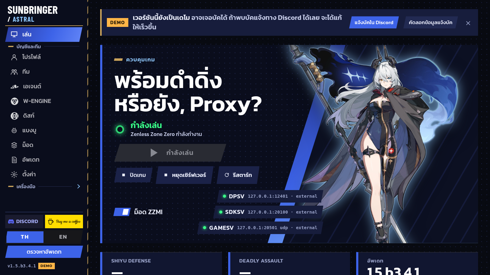

<p align="center">
  
</p>

<h1 align="center">Sunbringer Astral</h1>

<p align="center">
  <b>ตัวเปิดเกมและระบบจัดการเซิร์ฟเวอร์ Zenless Zone Zero</b><br>
  Launcher, Custom Server, Client Patch และตัวนับดาเมจในเกม ครบในตัวเดียว
</p>

<p align="center">
  <a href="https://github.com/thaxao/Sunbringer-Astral/releases"></a>
  
  
  
</p>

<p align="center">
  
</p>

---

## ติดตั้ง

### Windows (PowerShell)
```powershell
irm https://raw.githubusercontent.com/thaxao/Sunbringer-Astral/main/tools/install.ps1 | iex
```
ติดตั้งไปที่ `%LOCALAPPDATA%\Sunbringer-Astral` พร้อมทางลัดบน Desktop และ Start Menu

### Windows (Command Prompt)
```cmd
curl -fsSL https://raw.githubusercontent.com/thaxao/Sunbringer-Astral/main/tools/install.cmd -o install.cmd && install.cmd && del install.cmd
```

### Linux
```bash
curl -fsSL https://raw.githubusercontent.com/thaxao/Sunbringer-Astral/main/tools/install.sh | bash
```
ติดตั้งไปที่ `~/.local/share/sunbringer-astral` สร้างคำสั่ง `sunbringer-astral` และไอคอนในเมนูโปรแกรม

### Arch Linux (PKGBUILD)
```bash
git clone https://github.com/thaxao/Sunbringer-Astral.git
cd Sunbringer-Astral/packaging/aur/sunbringer-astral-bin
makepkg -si
```

หรือดาวน์โหลด zip เองได้ที่หน้า [Releases](https://github.com/thaxao/Sunbringer-Astral/releases) (มี `SHA256SUMS` ให้ตรวจไฟล์)

> **Windows ขึ้น "Windows protected your PC"?** กด **More info** แล้วกด **Run anyway**
> ถ้าดาวน์โหลด zip เอง ให้คลิกขวาที่ zip ก่อนแตกไฟล์ เลือก **Properties** แล้วติ๊ก **Unblock**
> รายละเอียดเพิ่มเติมอยู่ในหน้า **Help** ของลันเชอร์

---

## อัปเดต

### อัปเดตผ่านลันเชอร์
เปิดหน้า **Updates** แล้วกดอัปเดตแต่ละส่วนได้เลย ลันเชอร์ตรวจ checksum ทุกไฟล์ก่อนติดตั้ง และเก็บไฟล์เดิมไว้ย้อนกลับได้

### อัปเดตด้วยคำสั่ง (ไม่ต้องเปิดลันเชอร์)
ตั้งแต่ลันเชอร์ 1.5.4 ขึ้นไป (กำลังจะออก):

```bash
sunbringer-astral update --check     # ดูว่ามีอะไรใหม่บ้าง
sunbringer-astral update all         # อัปเดตทุกส่วน: ลันเชอร์, server, แพตช์, ตัวนับดาเมจ
sunbringer-astral update server      # อัปเดตเฉพาะส่วน: launcher | server | patch | meter
```

บน Windows ใช้ `sunbringer-astral.exe update all` ใน PowerShell หรือ Command Prompt
ปิดเกมและ server ก่อนอัปเดต server หรือแพตช์

อัปเดตเฉพาะตัวลันเชอร์ด้วยสคริปต์ติดตั้ง (ใช้ได้ทุกเวอร์ชัน):
```bash
curl -fsSL https://raw.githubusercontent.com/thaxao/Sunbringer-Astral/main/tools/install.sh | bash
```
```powershell
irm https://raw.githubusercontent.com/thaxao/Sunbringer-Astral/main/tools/install.ps1 | iex
```

---

## มีอะไรบ้าง

| ส่วน | ทำอะไร |
|---|---|
| **Launcher** | เปิดเกมและ server ในปุ่มเดียว, ติดตั้งและอัปเดตตัวเกมด้วย diff (hdiff / ZIFF), ตรวจและซ่อมไฟล์เกม |
| **บัญชีและทีม** | แก้ Agent, W-Engine, Drive Disc, Bangboo และทีมแบบ real-time ระหว่างเล่น, บันทึก Shiyu Defense และ Deadly Assault, สำรองเซฟอัตโนมัติ |
| **Custom Server** | server สำเร็จรูปสำหรับ Linux และ Windows อัปเดตจากลันเชอร์หรือคำสั่งได้ |
| **Client Patch** | `sunbringer.exe` + `sunbringer.dll` ลันเชอร์ติดตั้งและตรวจ hash ให้เอง |
| **Damage Meter** | ตัวนับดาเมจวาดในเกม: ดาเมจและ DPS ของแต่ละตัว, กราฟดาเมจตามเวลา<br>**Insert** เปิดเมนู ลากหรือปรับหน้าต่างได้ · **Insert / Esc** กลับเข้าเกม · **Home** ซ่อนแผง<br>อัปเดตแยกจาก [Sunbringer-Meter](https://github.com/thaxao/Sunbringer-Meter) |
| **Mods** | จัดการ ZZMI mods |
| **อื่น ๆ** | ตั้งค่ากราฟิก, เวลาเล่น, ภาพหน้าจอล่าสุด, รายงานตอนเกมหรือ server เด้ง, ตรวจความพร้อมของเครื่อง, ภาษาไทยและอังกฤษ |

---

## ถอนการติดตั้ง

ลบเฉพาะไฟล์ของลันเชอร์ และถามก่อนว่าจะลบการตั้งค่าและเซฟด้วยหรือไม่

```bash
curl -fsSL https://raw.githubusercontent.com/thaxao/Sunbringer-Astral/main/tools/uninstall.sh | bash
```
```powershell
irm https://raw.githubusercontent.com/thaxao/Sunbringer-Astral/main/tools/uninstall.ps1 | iex
```
Arch Linux: `sudo pacman -R sunbringer-astral-bin`

---

## ความต้องการของระบบ

- **Windows** 10 (1803 ขึ้นไป) หรือ 11 พร้อม Microsoft Edge WebView2 Runtime (มีมากับ Windows อยู่แล้ว)
- **Linux** GTK 3, WebKitGTK 4.1 (`webkit2gtk-4.1`), Wine สำหรับรันเกม, `curl`, `unzip`

---

## ใบอนุญาต

Sunbringer Astral ใช้ [Apache License 2.0](LICENSE)
Custom Server พัฒนาต่อจาก [Remielle](https://git.xeondev.com/remielle/remielle) โดย xeondev (AGPL-3.0)
ตัวนับดาเมจใช้ [Dear ImGui](https://github.com/ocornut/imgui) (MIT) และฟอนต์ Kanit (OFL)
